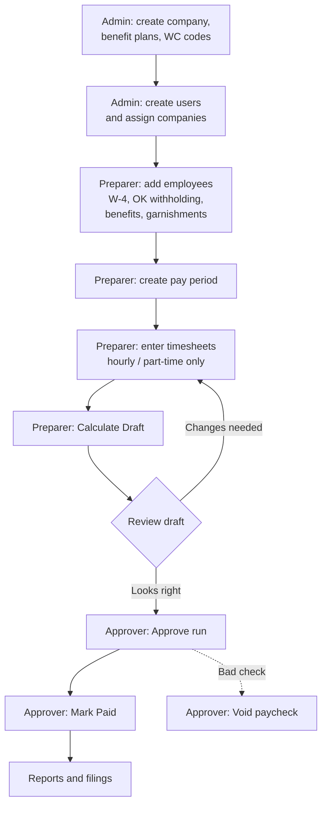
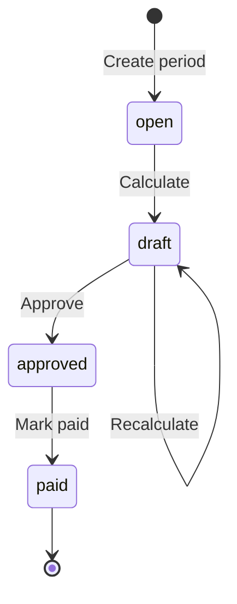
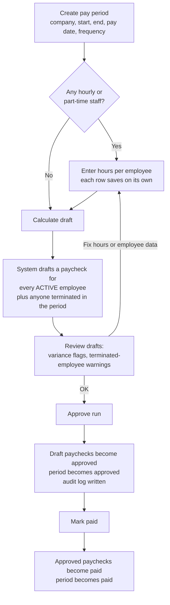
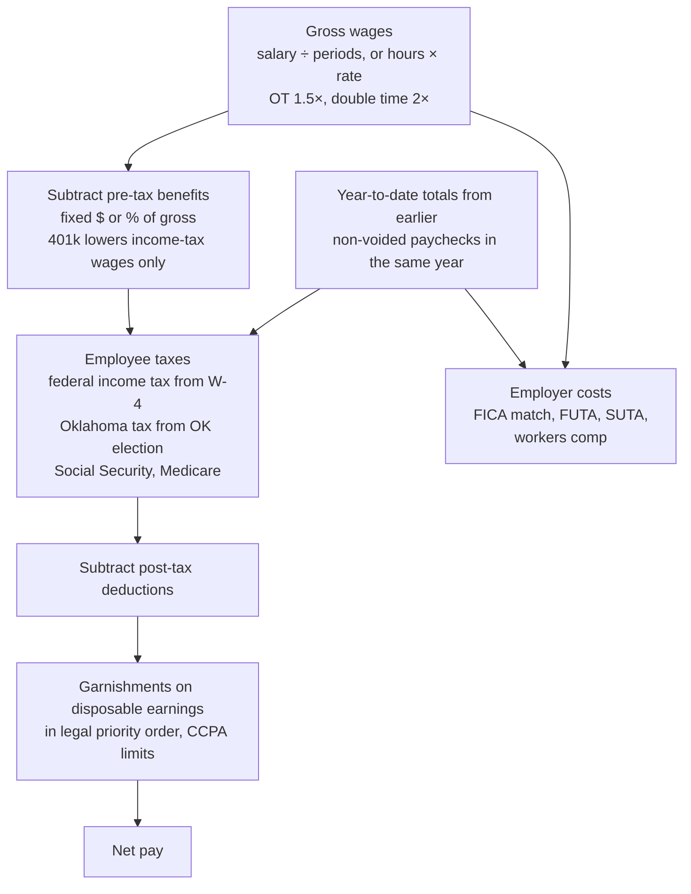
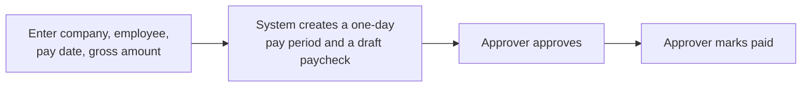
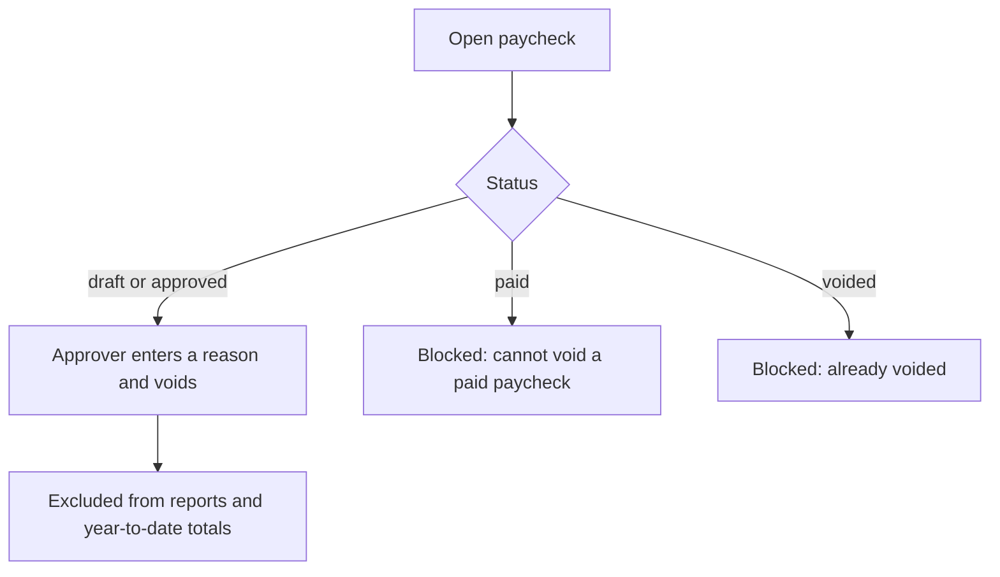
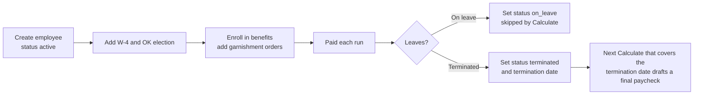
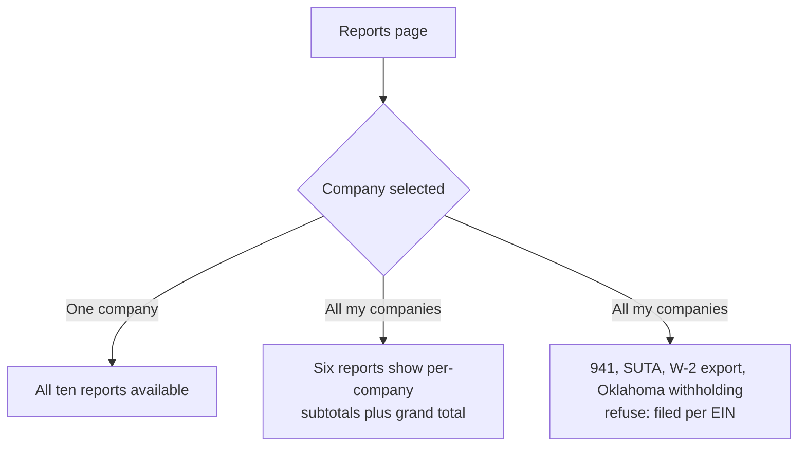
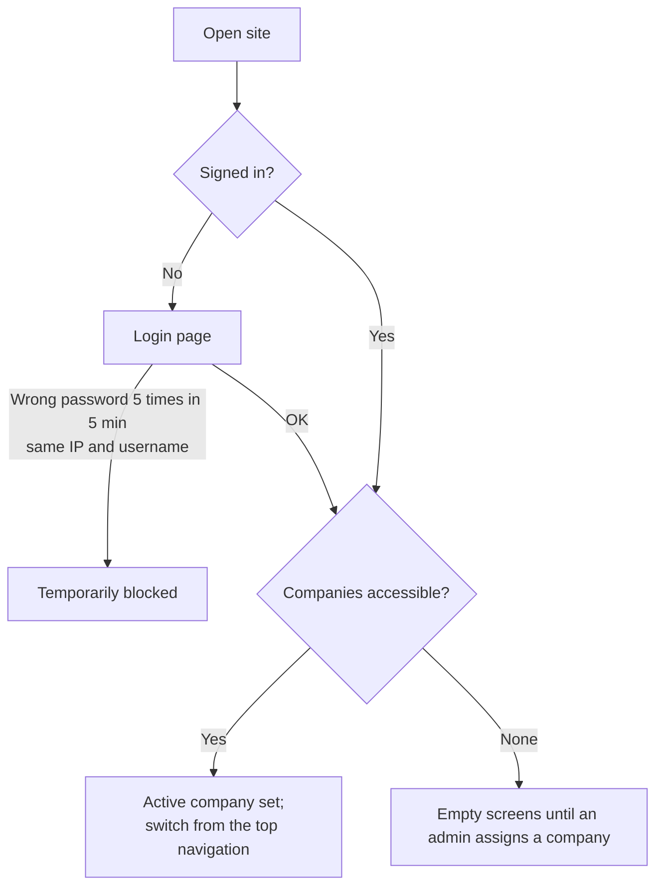

# Payroll Process Flow

How work moves through the system, from first-time setup to filing reports. Diagrams use [Mermaid](https://mermaid.js.org/) and render on GitHub. For step-by-step screen instructions, see [USER-MANUAL.md](USER-MANUAL.md).

## 1. Who can do what

Four roles control *what* a user may do. A separate company assignment controls *which companies* they may do it to. Admins bypass company assignment and see every company.

| Action | Admin | Preparer | Approver | Read-only |
|---|:-:|:-:|:-:|:-:|
| View employees, payroll, reports | ✓ | ✓ | ✓ | ✓ |
| Switch active company (among those assigned) | ✓ | ✓ | ✓ | ✓ |
| Add/edit employees, W-4 and Oklahoma elections, benefit enrollments, garnishments | ✓ | ✓ | | |
| Create pay periods and off-cycle payments, enter timesheets, calculate draft | ✓ | ✓ | | |
| Approve a payroll run, void a paycheck, mark a period paid | ✓ | | ✓ | |
| Company, benefit plan and workers comp code setup | ✓ | | | |
| User management and company assignment | ✓ | | | |

A user with no company assignment (other than an admin) sees no data. A record in a company the user cannot access returns "not found", not "forbidden".

## 2. End-to-end overview

## 3. Pay period lifecycle

A pay period moves in one direction. Each paycheck inside it has its own status.

| Period status | Timesheets editable | Can recalculate | Who moves it forward |
|---|:-:|:-:|---|
| `open` | Yes | Yes | Preparer (Calculate Draft) |
| `draft` | Yes | Yes | Approver (Approve) |
| `approved` | No | No | Approver (Mark paid) |
| `paid` | No | No | Final |

Paycheck status: `draft` → `approved` → `paid`. A paycheck can also become `voided`. Only paychecks in `draft` or `approved` can be voided; a `paid` paycheck cannot.

## 4. Payroll run, step by step

Notes on each step:

- **Calculate** replaces any existing draft paycheck for each employee, so it is safe to run repeatedly while the period is `open` or `draft`. It only drafts employees whose status is `active`.
- **Salaried** employees are paid annual salary divided by the number of periods in their pay frequency. Timesheets are ignored for them.
- **Hourly and part-time** employees are paid from their timesheet. With no timesheet, gross pay is $0.00.
- **Review flags** on the period page:
  - *Variance:* a draft whose gross differs from the employee's most recent approved or paid paycheck by more than 20%.
  - *No workers comp code on file:* active employees of the company with no code and not marked exempt, shown while the period is `open` or `draft`. Advisory only; it never blocks Calculate or Approve.
  - *Terminated employees needing a final paycheck:* terminated employees whose termination date is on or before the pay date and who have no paycheck in this period. Those terminated within the period (start date through pay date) are labelled *included when you calculate*; earlier terminations that never got a final paycheck are labelled *not included automatically*.
- **Approve** and **mark paid** only work from the expected prior status. Doing them out of order returns an error.
- **Check numbers.** Mark paid can take a first check number and numbers the approved paychecks consecutively, in paycheck order. All numbers are checked for clashes first, so a clash fails the whole run with nothing changed. A number must be unique among non-voided paychecks of the same company (a voided check's number can be reused). Approvers can also set, change or clear a number on an approved or paid paycheck; each change is audit-logged.

## 5. What happens when a paycheck is calculated

The tax engine (`tax_engine/`) is pure calculation; the payroll service gathers the inputs and saves the result.

Inputs the calculation reads:

| Input | Source |
|---|---|
| Pay rate, employment type, pay frequency | Employee record (frequency falls back to the company's) |
| Federal withholding | Employee's latest W-4 election; Single with no adjustments if none on file. An exempt W-4 withholds $0 through Feb 15 of the year after its effective date (compared with the pay date), then Single with no adjustments |
| Oklahoma withholding | Employee's latest Oklahoma election; single with 0 allowances if none on file. An exempt election withholds $0 and does not expire |
| Pre-tax and post-tax deductions | Active benefit enrollments. Fixed plans deduct a dollar amount; percent plans deduct that percent of the period's gross. An enrollment override uses the same unit as its plan. |
| Garnishments | Active garnishment orders |
| SUTA rate | Company setting; 2.7% if blank |
| Workers comp rate | Employee's workers comp code (rate per $100 of wages); none for an employee marked exempt from workers comp |
| Pre-tax treatment | Every pre-tax plan lowers federal and Oklahoma income tax wages. Only non-401k pre-tax plans (health, dental, vision, FSA, HSA, other) also lower Social Security, Medicare, FUTA and SUTA wages; a traditional 401(k) deferral does not (`FICA_TAXABLE_PRE_TAX_TYPES`). Employer FICA follows the same wages. |
| Year-to-date wages | Earlier non-voided paychecks in the same calendar year: gross less Section 125 pre-tax deductions. Post-tax deductions, garnishments and 401(k) deferrals are not subtracted, because the Social Security, FUTA and SUTA wage bases count wages paid, not take-home pay |

**Employer match.** A plan with a match percentage adds an employer contribution line: the match percent of the employee's contribution, counting at most the cap percent of gross pay. For example, "100% up to 4%" on a $2,500 check matches at most $100. The match is employer money, so it never reduces the employee's net pay or appears in their deductions.

**Client liabilities.** Each calculated paycheck also records what must be sent to outside parties: one entry per garnishment order (to its payee), and one per benefit plan (to the plan, including any employer match). Retirement plans are typed as retirement deposits, other plans as benefit premiums, child support as child support remittances. The Client liabilities report counts these once the paycheck is approved. Drafts owe nothing, recalculating replaces them, and a voided paycheck drops out. An approver marks them sent from the report with **Mark Remitted**, which stamps `remitted_at` and an optional reference on every outstanding entry for that payee, company and year (audit-logged per entry).

Garnishment priority: child support, federal tax levy, state tax levy, student loan, creditor and bankruptcy, then other. Amounts are capped by the Consumer Credit Protection Act limits. Disposable earnings are gross pay less the taxes required by law (federal and Oklahoma income tax, Social Security, Medicare). Voluntary deductions such as health premiums and 401(k) deferrals are not subtracted, so they do not reduce the amount a creditor or support order can take. Some states let certain support orders net out health insurance premiums; that is not modeled.

## 6. Off-cycle payment

For a one-off payment to one employee outside the normal schedule.

The new period starts in `draft` so it follows the normal approve and mark-paid steps. For hourly and part-time employees the gross amount is converted to hours at their pay rate. For salaried employees the amount entered is the gross for that paycheck, in place of their per-period salary. For a salaried employee, the description you enter labels the earnings line; hourly paychecks keep their normal "Regular Pay" line.

## 7. Voiding a paycheck

The reason, user and time are saved. Voiding one paycheck does not change the pay period's status. A voided check is not replaced automatically.

## 8. Employee lifecycle

Employees with status `active` are included in a payroll run, plus `terminated` employees whose termination date is between the period start date and its pay date (their final paycheck). A final paycheck for a salaried employee is the period salary prorated by calendar days, start through termination date, capped at the period end (`final_pay_fraction`); hourly pay follows the timesheet. Off-cycle amounts are never prorated. Accrued time-off payouts are not modeled. W-4 and Oklahoma elections are kept as history; the newest one by effective date is used. An employee with no election is withheld as single with no adjustments / 0 allowances, never $0. Benefit enrollments and garnishment orders are ended by giving an end date (they are not deleted).

## 9. Reports and filing scope

| Report | Consolidated across companies |
|---|:-:|
| Payroll register | Yes |
| Tax liability | Yes |
| Workers comp | Yes |
| Deductions and benefits | Yes |
| Client liabilities | Yes |
| New hire reporting | Yes |
| Quarterly 941 | No, run per company |
| Oklahoma SUTA | No, run per company |
| Oklahoma withholding | No, run per company |
| W-2 CSV export | No, run per company |

Reports count only approved and paid paychecks. Drafts and voided paychecks are left out, so totals do not change while a run is under review. The exception is the payroll register, which lists every paycheck in the chosen period, drafts included, for review before approval.

**Oklahoma SUTA report.** For one company and quarter, lists each employee paid in the quarter with total wages, taxable wages, excess wages and contributions. Only approved and paid paychecks count. Taxable wages apply the Oklahoma wage base ($27,000 per employee per year, the tax engine's constant) to the employee's year-to-date subject wages (gross less cafeteria-plan pre-tax deductions; 401(k) deferrals stay in) in pay date order, so earlier quarters and earlier paychecks use up the base first. Excess wages are total wages minus taxable wages. Contributions are the sum of the SUTA lines already calculated on the paychecks, so a mid-year rate change shows what was actually withheld. SSNs are shown as last four digits only.

## 10. Access and session flow

Access is re-checked on every request. If an admin removes a company from a user, it takes effect on that user's next click, not at next login. Every form that changes data is protected by a CSRF token.

## 11. Audit trail

The audit log records who changed what and when for: employee create and update, marking a new hire as reported, pay period create (including off-cycle), paycheck approve and void, user role and active-flag changes, and company assignment grants and revokes.

## 12. Known limitations

These are current behaviors, not bugs in your data:

- **Remittances are marked per payee, not per payment.** **Mark Remitted** covers everything outstanding for a payee, company and year. There is no partial amount and no undo.
- **Recalculating an off-cycle period redrafts everyone.** An off-cycle payment lives in its own one-day pay period. Choosing Recalculate on it drafts every active employee in the company, not just the one paid, and a salaried employee's entered amount is replaced by their normal salary. Approve the off-cycle period as created; to change it, void the paycheck and create a new off-cycle payment.
- **Employer share of insurance premiums** is not modeled. Only the employee's deduction (plus any employer match on the plan) appears in client liabilities.
- **Hourly minimum wage check** ($7.25) applies when creating an employee.
- The site runs over plain HTTP in the Docker test deployment. Use test data only.
